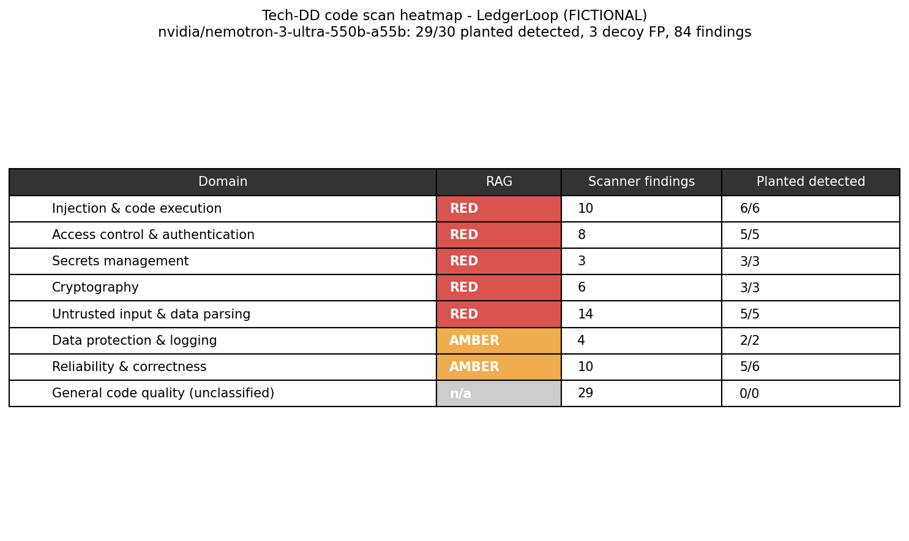

# pe-techdd-code-scan

> **Prototype.** This is a demonstration built on synthetic data only. It is not production software and has not been validated for real use. See [Limitations](#limitations-and-caveats).

**An honest, measured trial of AI code review for private-equity technology due diligence.**

This repo runs [Open Code Review](https://github.com/alibaba/open-code-review) (Alibaba, Apache-2.0), unmodified,
against a **fictional** SaaS codebase with a known list of planted defects. It then scores what the tool found,
turns the findings into the kind of red/amber/green heatmap a deal team would read, and drafts a 100-day
remediation plan.

> Everything here is synthetic. "Quillmoor Ledger Ltd" and its product "LedgerLoop" do not exist. All
> "secrets" in the fixture are obviously fake strings marked `FAKE`. No client code or data was used.

## Why this matters for PE tech DD and exit readiness

- **Diligence windows are short.** A deal team rarely gets more than a couple of weeks of code access. An AI-assisted
  first pass can cover a whole repository quickly and point experts at the riskiest areas.
- **Findings must be defensible.** Investment committees need to know how much to trust a scan. This repo measures
  recall, precision and false alarms against ground truth instead of taking a vendor's word for it.
- **Exit readiness.** The same scan, re-run before a sale, shows a buyer that critical issues were found and fixed.
  The 100-day plan is the bridge between "what we found" and "what we did about it".

## What is in the repo

```
fixture/quillmoor-ledger/   fictional Flask + JS invoicing app (~900 lines) with planted defects and safe decoys
ground_truth/manifest.json  30 planted issues (17 categories, 4 severities) + 15 decoys, located by anchor text
scripts/                    prepare_workspace.sh, run_scan.sh, session_stats.py, score_all.py, build_reports.py
src/techdd_scan/            matching.py (deterministic scoring), heatmap.py (RAG + remediation)
results/<run>/              real tool output (scan.json), scrubbed stderr log, run_meta, session_stats, score
results/summary.json        per-run metrics, cross-run consistency, total calls/tokens
reports/                    findings.md, heatmap.md/.html/.png, remediation_100_day.md
tests/                      pytest: manifest integrity, matching rules, fixture hygiene, results/README consistency
```

## Architecture

```
fixture/ ──copy──> isolated git repo (/tmp) ──ocr scan──> results/<run>/scan.json
                    (ground truth NOT copied,              │
                     so the agent cannot read it)          ▼
ground_truth/manifest.json ──────────────> scripts/score_all.py (src/techdd_scan/matching.py)
                                                           │
                                                           ▼
                         results/<run>/score.json + results/summary.json
                                                           │
                                                           ▼
                scripts/build_reports.py ──> reports/ (findings, heatmap, 100-day plan) + README results block
```

- **Scanner:** `ocr scan` (whole-file review, no diff) from `@alibaba-group/open-code-review@1.14.0`
  (upstream tag `v1.14.0`, commit `d29ca2044a42ea297a7fa93692d0f5ac8f38d84e`). Default settings apart from
  `--concurrency 4` and a 60-minute task budget.
- **Model endpoint:** any OpenAI-compatible Chat Completions endpoint with tool calling. The recorded runs used the
  NVIDIA API catalog (`https://integrate.api.nvidia.com/v1`) with `nvidia/nemotron-3-ultra-550b-a55b` (3 complete
  runs). A fourth run with `mistralai/mistral-large-4-1t-a52b` was started but stopped by hand because the endpoint
  was too slow (3 of 23 files reviewed in about 28 minutes); it produced no results and is excluded from scoring, but
  its token use is recorded in `results/run4-mistral-large/aborted_run.json`. `temperature: 0` is sent through OCR's
  `extra_body`; the model still produced different output on repeat runs (see results).
- **Key handling:** the run script reads the key file into an environment variable for that process only and points
  OCR at it with `api_key_cmd = printenv DEMO_LLM_API_KEY`, using an isolated OCR home under `/tmp`. The key is never
  written to config, arguments, logs or results; logs are scrubbed as a second line of defence.

## Setup

Requirements: Git >= 2.41, Node 18+, Python 3.12.

```bash
npm install                      # installs the pinned OCR CLI (package.json)
export OCR_BIN="$PWD/node_modules/.bin/ocr"
python3 -m venv .venv && .venv/bin/pip install -r requirements.txt
.venv/bin/python -m pytest -q    # tests run offline
```

## Run it with your own OpenAI- or Anthropic-compatible key

```bash
# OpenAI-compatible endpoint (OpenAI, Azure OpenAI gateway, NVIDIA, a private vLLM, ...)
printf '%s' "<your key>" > ~/.secrets/llm_key && chmod 600 ~/.secrets/llm_key
OCR_API_KEY_FILE=~/.secrets/llm_key \
OCR_BASE_URL=https://api.openai.com/v1 \
scripts/run_scan.sh run5-mymodel gpt-4.1

.venv/bin/python scripts/score_all.py
.venv/bin/python scripts/build_reports.py
```

For an Anthropic-protocol endpoint, set `protocol` to `anthropic` in `scripts/run_scan.sh` (OCR supports
`openai`, `openai-responses`, `anthropic` and `anthropic-bedrock`; see the
[OCR configuration docs](https://open-codereview.ai/docs/configuration)). The model must support native tool calls.

## Results

All figures below are generated from `results/` by `scripts/build_reports.py`; a test fails if this block drifts
from `results/summary.json`.

<!-- RESULTS:START (generated by scripts/build_reports.py - do not edit by hand) -->
| Run | Model | Findings | Planted detected | Recall | Strict precision | TP findings | Duplicates | Near misses | Decoy FPs (decoys) | Unplanted | LLM calls | Input tokens | Output tokens | Elapsed |
|---|---|---|---|---|---|---|---|---|---|---|---|---|---|---|
| run1-nemotron-ultra | `nvidia/nemotron-3-ultra-550b-a55b` | 84 | 29/30 | 96.7% | 38.1% | 32 | 5 | 14 | 3 (D02, D05, D10) | 35 | 53 | 306,001 | 56,438 | 7m34s |
| run2-nemotron-ultra | `nvidia/nemotron-3-ultra-550b-a55b` | 91 | 29/30 | 96.7% | 38.5% | 35 | 7 | 20 | 1 (D07) | 35 | 49 | 279,349 | 53,688 | 8m20s |
| run3-nemotron-ultra | `nvidia/nemotron-3-ultra-550b-a55b` | 89 | 28/30 | 93.3% | 32.6% | 29 | 3 | 18 | 1 (D02) | 41 | 66 | 405,256 | 68,396 | 9m30s |
| **Total** | | | | | | | | | | | **168** | **990,606** | **178,522** | |

Primary run `run1-nemotron-ultra`: **29/30 planted issues detected (recall 96.7%)**,
strict precision 38.1% (32 of 84 findings matched a planted issue),
3 false positive(s) on 15 decoys, 5 duplicate(s).
Across 3 `nemotron-3-ultra` runs: detected 28-29 of 30, findings 84-91.
Across all 3 runs: 27 issues found every time; never found: none.
Totals for all runs: 168 LLM calls, 990,606 input + 178,522 output tokens.
Aborted, not scored: `run4-mistral-large` (`mistralai/mistral-large-4-1t-a52b`) - 3 of 23 files reviewed, 31 LLM calls, 132,230 prompt + 21,551 completion tokens (from OCR's session log). Reason: Endpoint responses were far slower than for Nemotron (first response took 66 s); after about 28 minutes only 3 of 23 files had been reviewed, so the run was stopped to keep time and token use reasonable. No scan.json was produced and this run is excluded from all scoring.

<!-- RESULTS:END -->

Details: [reports/findings.md](reports/findings.md) · Heatmap: [reports/heatmap.md](reports/heatmap.md)
([PNG](reports/heatmap.png), [HTML](reports/heatmap.html)) · Plan: [reports/remediation_100_day.md](reports/remediation_100_day.md)



## Scoring method

Matching is deterministic and lives in `src/techdd_scan/matching.py` (rules version 2):

1. Each manifest entry is located by **anchor text** (exact substrings of the target line), so line numbers cannot
   drift. A planted issue can list **related** locations in other files on the same data flow (e.g. the route that
   passes user input to a vulnerable helper).
2. **Location match:** same file (or a related file) and the finding's line range within **±3 lines** of a target line.
3. **Category match:** the finding's prose (not the code it quotes) matches a keyword pattern for the planted category.
4. A finding with both is a **true positive** and credits every planted issue it matches. Further findings on an
   already-credited issue are **duplicates**.
5. Location but wrong category = **near miss**. Otherwise, a finding within **±2 lines** of a decoy whose prose
   matches the decoy's "lure" category is a **decoy false positive**; anything else is **unplanted**.
6. **Strict precision** counts every non-matching finding (near misses, decoy FPs, unplanted) as a false positive,
   even though many unplanted findings are real issues. A manual triage of the primary run is in
   `results/run1-nemotron-ultra/manual_triage.json` and clearly labelled as judgement.

**Disclosure:** the rules were revised once, after inspecting run 1 and before runs 2-4 were scored. Version 1
used loose keywords (e.g. any mention of "log" counted as sensitive logging), credited only one issue per finding,
counted any comment near a decoy as a decoy false positive, and had no related locations. Version 2 is stricter on
keywords and decoys but adds related locations and multi-issue credit. Keyword matching is still imperfect: the
triage file lists two findings in run 1 that the rules credited for the wrong reason. Neither changed recall,
because the same issues were also found by correctly matched findings.

## Limitations and caveats

- **Third-party model.** The fixture's code was sent to a hosted model API. That is fine for fictional code. Real
  client or target code needs written consent from the code owner and a private endpoint or clean room (e.g. a model
  deployed in the client's own cloud tenancy).
- **Synthetic, small, obvious.** About 900 lines with deliberately textbook defects. Real codebases are larger,
  the defects are subtler and cross many files. Do not read the recall here as a prediction for a real target.
- **One model.** Only one model completed runs, so this says nothing about how other models compare.
- **Run-to-run variance.** Even at temperature 0 the findings changed between runs. A DD process should merge
  several runs or pair the scan with deterministic tools (SAST, secret scanning, dependency audit).
- **Repo maturity.** The public Open Code Review repository was created in May 2026 and changes quickly; v1.14.0
  was tagged on 21 Nov 2026, the day of these runs. Pin versions and re-validate on upgrade.
- **Vendor benchmark claims.** The upstream README reports precision/recall on its own benchmark (AACR-Bench).
  Those are the vendor's numbers; this repo does not reproduce them.
- **Severity is a rubric, not tool output.** OCR's JSON output has no severity field, so the heatmap assigns
  severity by category. Treat RAG as a triage aid, not a rating.
- **Coverage.** Only `ocr scan` with default rules was exercised. No dependency (SCA), infrastructure, licence or
  architecture review was done. Those are core parts of tech DD and need other tools.
- **Independence.** For any audit client, check independence rules before offering code-scanning or remediation
  services, and keep findings work separate from attest work.

## How this could become a client service

- **Buyer:** PE deal teams and Operating Partners, especially for software and tech-enabled targets. A second motion
  is exit readiness for portfolio companies.
- **Offer:** a fixed-fee scan of about two weeks, run on a private model endpoint inside an agreed clean room. It
  covers the codebase scan, expert validation of findings, a RAG heatmap for the investment committee, and a costed
  100-day remediation plan. Re-scans at day 100 and pre-exit are the follow-on work.
- **Where the value sits:** not in the tool, which is free and open source. It is in the validation rubric, the
  scoring method that tells the IC how far to trust the scan, the heatmap format, the remediation plan and the
  expert judgement to separate real risk from noise. This repo shows that layer in miniature.
- **Before taking it to market:** run it on real codebases under consent; check procurement and data-residency
  concerns about the tool and the model; agree how it fits with existing tech-DD and cyber offerings; and complete
  independence checks for audit clients.

## Licence and credits

MIT for this repo's own code and documents (see [LICENSE](LICENSE)). Open Code Review is © 2026 Alibaba and licensed
under Apache-2.0. It is installed from npm and not vendored or modified here.
